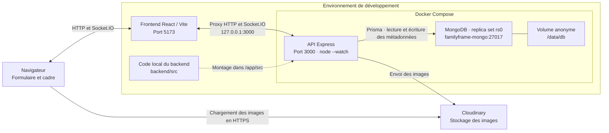

# FamilyFrame

Projet pédagogique de cadre photo connecté en JavaScript. Le backend peut tourner en local avec MongoDB Atlas ou dans Docker avec sa propre base MongoDB.

Deux façons de lancer le projet avec Docker : [Docker Compose](#lancer-familyframe-avec-docker-compose)
en une commande, ou [Docker CLI](#lancer-familyframe-avec-docker-cli) en lançant
les conteneurs à la main. Les deux méthodes utilisent le port 3000.

## Lancer FamilyFrame avec Docker Compose

Démarrer Docker Desktop. Depuis la racine du projet, créer le fichier local de
configuration s'il n'existe pas encore :

```bash
cp -n backend/.env.example backend/.env
```

Garder `PORT=3000` dans `backend/.env`. Pour envoyer des photos, renseigner
`CLOUDINARY_CLOUD_NAME`, `CLOUDINARY_API_KEY` et `CLOUDINARY_API_SECRET`.
Compose fournit l'adresse de MongoDB, donc aucun compte Atlas n'est nécessaire
avec cette méthode. Garder `backend/.env` sur sa machine.

Toujours depuis la racine du projet :

```bash
docker compose up --build
```

Compose construit l'image de l'API à partir du Dockerfile du backend et démarre
MongoDB. Son contrôle de santé initialise le replica set sur une base neuve.
L'API attend que MongoDB soit primaire avant de démarrer. Les deux services
utilisent le réseau de Compose et MongoDB stocke ses données dans un volume
anonyme monté sur `/data/db`.

Dans Bruno, envoyer `GET http://localhost:3000/health` pour vérifier que l'API
répond, puis `GET http://localhost:3000/photos` pour vérifier la lecture dans
MongoDB. Sur une base vide, `/photos` renvoie `[]`. Pour utiliser l'interface,
lancer Vite comme indiqué dans la section [Frontend](#frontend).

Sur une base neuve, on peut appliquer le schéma Prisma pour créer la collection
`photos` et son index de date. Depuis un autre terminal à la racine :

```bash
docker compose exec api pnpm db:push
```

### Tester le live reload

Avec Compose en cours d'exécution, modifier temporairement la réponse de
`/health` dans `backend/src/app.js` et sauvegarder dans VSCode. Le montage
`./backend/src:/app/src` rend la modification visible dans le conteneur.
`node --watch` redémarre l'API. Renvoyer la requête dans Bruno pour voir la
nouvelle réponse, puis rétablir la réponse d'origine.

`Ctrl+C` arrête les services. Relancer `docker compose up` pour reprendre avec
les mêmes conteneurs et retrouver le volume de données. Éviter `docker compose
down` si l'on veut réutiliser automatiquement ce volume anonyme au prochain
démarrage.

## Lancer FamilyFrame avec Docker CLI

Préparer le même fichier `backend/.env` que pour Compose. Si l'API de Compose
tourne, l'arrêter d'abord pour libérer le port 3000.

### Construire l'image et démarrer MongoDB

Depuis la racine du projet :

```bash
docker build -t test1 ./backend
docker network create familyframe-net
docker run -d \
  --name familyframe-mongo \
  --network familyframe-net \
  --mount type=volume,source=familyframe-mongo-data,target=/data/db \
  mongo:8.0 mongod --replSet rs0 --bind_ip_all
```

Le réseau et le conteneur MongoDB se créent une seule fois. Le volume nommé
`familyframe-mongo-data` conserve les données de cette installation.

Quand MongoDB accepte les connexions, initialiser le replica set sur la base neuve :

```bash
docker exec familyframe-mongo mongosh --quiet --eval 'rs.initiate({
  _id: "rs0",
  members: [{ _id: 0, host: "familyframe-mongo:27017" }]
})'
docker exec familyframe-mongo mongosh --quiet --eval 'db.hello().isWritablePrimary'
```

Attendre que la dernière commande renvoie `true` avant de lancer l'API.

### Démarrer et tester l'API

Toujours depuis la racine du projet :

```bash
docker run \
  --name familyframe-api \
  --network familyframe-net \
  --env-file ./backend/.env \
  --env 'DATABASE_URL=mongodb://familyframe-mongo:27017/familyframe?replicaSet=rs0' \
  -p 127.0.0.1:3000:3000 \
  -v ./backend/src:/app/src \
  test1
```

Garder ce terminal ouvert. Dans un deuxième terminal, `docker ps` affiche les
conteneurs en cours d'exécution. Sur une base neuve, on peut créer la collection
et son index avec `docker exec familyframe-api pnpm db:push`.
Les tests `/health`, `/photos` et de live reload décrits dans la section Compose
fonctionnent de la même façon.

Pour arrêter les conteneurs, utiliser `docker stop familyframe-api familyframe-mongo`.
Au prochain lancement, réutiliser les conteneurs avec `docker start familyframe-mongo`,
attendre que MongoDB soit primaire, puis lancer `docker start familyframe-api`.

## Prérequis pour le frontend et le backend sans Docker

Node.js 24 et pnpm. Projet vérifié avec Node.js 24.8.0 et pnpm 12.15.0.
Un compte Cloudinary est nécessaire pour envoyer des photos. MongoDB Atlas est utilisé pour le démarrage du backend sans Docker.

Pour créer les accès :

1. [Créer un compte Cloudinary](https://cloudinary.com/users/register_free), puis ouvrir
   Console → Settings → API Keys pour récupérer le cloud name, l'API key et l'API secret.
2. Dans [MongoDB Atlas](https://cloud.mongodb.com/), créer un projet FamilyFrame et un cluster Free/M0.
   Créer un utilisateur de base de données, autoriser l'IP courante, puis utiliser Connect → Drivers
   pour récupérer l'URI. Ajouter `/familyframe` entre le nom d'hôte et les paramètres commençant par `?`.

Références : [cluster gratuit Atlas](https://www.mongodb.com/docs/atlas/tutorial/deploy-free-tier-cluster/)
et [connexion de l'application](https://www.mongodb.com/docs/atlas/driver-connection/).

## Configuration du backend sans Docker

```bash
cd backend
pnpm install
cp -n .env.example .env
```

Renseigner les valeurs dans `backend/.env`, uniquement sur sa machine :

| Variable | Valeur attendue |
| --- | --- |
| `DATABASE_URL` | URI MongoDB Atlas incluant le nom de base `familyframe`. |
| `CLOUDINARY_CLOUD_NAME` | Nom du cloud Cloudinary. |
| `CLOUDINARY_API_KEY` | Clé API Cloudinary. |
| `CLOUDINARY_API_SECRET` | Secret API Cloudinary. |
| `PORT` | Port du backend, `3000` par défaut. |

Les identifiants dans l'URI MongoDB sont ceux d'un utilisateur de base de données.
Les caractères spéciaux du mot de passe doivent être encodés pour une URL.
Autoriser l'adresse IP de la machine dans Atlas.

Après avoir renseigné le fichier :

```bash
pnpm db:generate
pnpm db:push
```

`db:generate` produit le client JavaScript Prisma 6 à partir du schéma.
`db:push` synchronise le modèle avec MongoDB et crée l'index de date ; MongoDB n'utilise pas Prisma Migrate.
La configuration pnpm du backend autorise uniquement les scripts nécessaires à Prisma.
Les secrets ne doivent jamais être copiés dans le frontend ni committés dans Git.

## Frontend

```bash
cd frontend
pnpm install
pnpm dev
```

Ouvrir l'adresse affichée dans le terminal. Vite utilise le port 5173 par défaut.

```bash
pnpm lint
pnpm build
```

`lint` analyse le code ; `build` génère l'application dans `dist/`.

## Démarrer le backend sans Docker

```bash
cd backend
pnpm start
```

`pnpm start` démarre l'API sans surveillance des fichiers.

Garder les deux terminaux ouverts : un pour le backend, un pour le frontend.
Redémarrer le backend après une modification du fichier `.env`.
Si le port du backend change, adapter aussi les cibles du proxy dans `frontend/vite.config.js`.

Pour vérifier que l'API répond, ouvrir <http://localhost:3000/health> ou exécuter :

```bash
curl http://localhost:3000/health
```

La réponse contient `"status": "ok"` si le serveur tourne. Pour vérifier la connexion à MongoDB, utiliser `/photos`.

## Utilisation

- `http://localhost:5173/` : pseudo, sélection ou prise de photo, envoi.
- `http://localhost:5173/cadre` : dernière photo et anciennes photos consultables.
- Limite : 5 Mo par fichier et 50 caractères pour le pseudo.
- Le serveur refuse les images invalides ou non décodables ; les formats disponibles dépendent de Sharp.

La sélection d'image et la prise de photo ont deux champs distincts : l'attribut `capture`
peut ouvrir directement l'appareil photo sur certains téléphones. Le fichier retenu est indiqué à l'écran.

Pour essayer depuis un téléphone connecté au même réseau : lancer le frontend avec
`pnpm dev --host 0.0.0.0`, puis utiliser l'adresse réseau affichée par Vite sur le téléphone.
Le proxy Vite transmet les requêtes API et Socket.IO au backend ; le téléphone n'utilise pas son propre localhost.
La prise de photo doit encore être vérifiée sur un appareil physique.

## Schéma d'architecture

En développement avec Compose, Vite tourne sur l'ordinateur et transmet les
requêtes à l'API par le port 3000. MongoDB est accessible à l'API sur le réseau
de Compose. Cloudinary stocke les images et MongoDB conserve leurs métadonnées.



## Le parcours d'une photo

1. React rassemble le pseudo et le fichier dans `FormData`, puis appelle `POST /api/photos`.
2. Vite transmet la demande à la route Express `POST /photos`.
3. Multer reçoit le fichier en mémoire et limite sa taille.
4. Sharp décode le contenu, applique l'orientation, limite la taille à 1920 × 1920 pixels
   et réencode en JPEG sans conserver les métadonnées. L'entrée est limitée à 25 millions de pixels.
5. Cloudinary stocke ce JPEG et renvoie une URL et un identifiant.
6. Prisma enregistre ces informations, le pseudo et la date dans MongoDB.
7. Socket.IO diffuse `photo:new` après l'enregistrement ; le cadre l'affiche immédiatement.

Au démarrage et à la reconnexion, le cadre récupère `GET /photos`.
Il fusionne les résultats et les événements, sans doublons, en gardant la photo la plus récente en premier.
Si l'enregistrement en base échoue après l'upload, le serveur tente de supprimer l'image Cloudinary.

## API

| Route | Rôle |
| --- | --- |
| `GET /health` | Vérifier que le serveur répond. |
| `GET /photos` | Lire les photos de la plus récente à la plus ancienne. |
| `POST /photos` | Envoyer un formulaire multipart avec `pseudo` et un fichier `photo`. |

Une création réussie répond en HTTP 201. Un formulaire invalide répond 400,
un fichier trop volumineux 413 et une image non acceptée 415.
Une configuration absente répond 503 ; les autres échecs renvoient un message générique sans secrets.

## Intégration continue

Sur un push vers `dev`, [GitHub Actions](.github/workflows/ci.yml) lance les
tests du frontend (Node et Jest) et du backend. Si tout passe, le workflow
construit l'image de l'API et la publie sous
`ghcr.io/simplon-dist-cda-260316/familyframe-serah-api:dev`.

Sur une pull request vers `main`, le workflow lance les tests. La branche
`main` exige une pull request et un résultat positif du job `tests`, y compris
pour les administrateurs. La [PR de vérification #2](https://github.com/SIMPLON-DIST-CDA-260316/familyframe-serah/pull/2)
montre le blocage avec un test volontairement faux.

L'organisation Simplon garde le package privé. Pour récupérer l'image, il
faut avoir accès au package et se connecter à GHCR.

```bash
docker login ghcr.io -u VOTRE_IDENTIFIANT_GITHUB
docker pull ghcr.io/simplon-dist-cda-260316/familyframe-serah-api:dev
```

Pour la connexion manuelle, utiliser un jeton personnel classique doté de
`read:packages`. Le workflow utilise son propre `GITHUB_TOKEN`.

## Vérifications

Dans le backend :

```bash
pnpm test
```

Dans le frontend :

```bash
pnpm test
pnpm lint
pnpm build
```

Les tests backend utilisent le vrai Express, Multer et Sharp, avec des substituts pour Cloudinary et Prisma.
Ils n'envoient aucune image vers un compte Cloudinary et ne se connectent pas à Atlas.
Un parcours dans Chrome a également été vérifié avec deux onglets et ces services substitués :
envoi, mise à jour Socket.IO sans rechargement, historique, erreurs et affichage sur une largeur mobile.

Le 23 novembre 2026, le parcours a ensuite été validé avec les **vrais comptes Cloudinary et Atlas** :
deux images envoyées depuis le formulaire, affichage en direct sur le cadre, historique et récupération
des mêmes documents après redémarrage du backend. Ces deux images de démonstration sont conservées.
Le résultat détaillé figure dans [le suivi des tâches](docs/TASKS.md).

Pour reproduire la vérification avec les vrais services après configuration de `.env` :

1. Ouvrir le formulaire et le cadre dans deux onglets.
2. Envoyer une photo : vérifier son apparition sans actualisation.
3. Vérifier l'image sur Cloudinary et le document dans MongoDB Atlas.
4. Envoyer une seconde photo et consulter la première dans l'historique.
5. Redémarrer le backend et recharger le cadre : vérifier que les photos persistent.

## Suivi

- [Spécifications](docs/SPEC.md)
- [Tâches](docs/TASKS.md)
- [Trame de présentation](docs/PRESENTATION.md)
